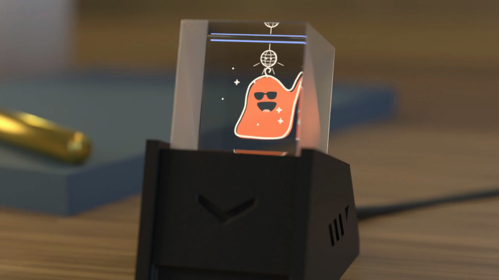
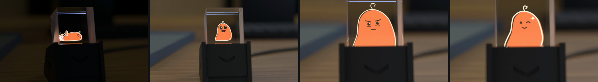
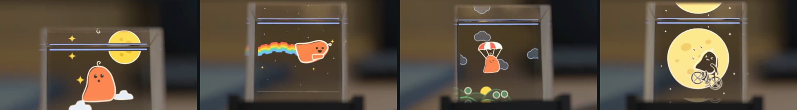
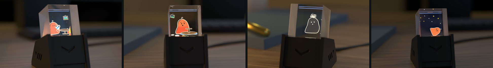

# Lump, a desk buddy for Claude



Lump is a little blob who lives in a tiny glass prism display on your desk and shows
you what your Claude sessions are up to, so you can look away from the screen while Claude works.

- **Working** while Claude Code is busy, **waving for attention** when a session needs you
  (a permission prompt, a question, a plan to approve), and **celebrating** when it's done.
- Corner counters show how many sessions are working, waiting on you, or finished and unread.
- His colour warms from tangerine to red as you get close to your Claude usage limits.
- **Tap the glass** and he plays one of eleven gags: electric shock, ring of fire, wolf howl,
  banana peel, cartoon bomb and more.
- Optional extras: turns blue before calendar meetings, holds up a letter when a Slack VIP
  messages you, a tiny ocarina voice and sound effects for the gags, sleeps at night, and runs over Wi-Fi with over-the-air updates.

Lump was built with Claude Code, drawings included: Claude draws every frame in code, in a scratchy
hand-drawn style, in one web page (`design/lump.html`), and a script bakes it into a file the ESP32
plays back at 24 fps.

<!-- The video: drag lumps_day_small.mp4 onto this line in GitHub's editor, and it becomes a player. -->





This is a fork of [Lump by Joe Bentham](https://github.com/joebentham/desk-buddy). It adds:

- **Drawings as instructions.** Each frame is stored as the canvas calls that drew it and redrawn by
  the board, about a kilobyte a frame where pixels took eight times that.
- **Clips.** Over 230 extra animations that reach him over Wi-Fi, with no flashing, and that he
  plays by himself when the moment fits.
- **A skill for making more.** Ask Claude Code for a new animation and it is written, checked and
  playing on his screen in about a minute.
- **A video of him**, made from a Blender model of the device with his real animations on its screen.

## What you need

- **The display:** Waveshare / SpotPear **ESP32-S3-LCD-1.3** "prism" (ESP32-S3R8, 16 MB flash,
  8 MB PSRAM, 240×240 ST7789 behind a glass cube, motion sensor for taps). Lump was built on
  [this AliExpress listing](https://www.aliexpress.com/item/1005009887388696.html), colour option
  **ESP32-S3-LCD-1.3-C** (about $20). Keep its stock case: the mount is sized for it.
- **A USB-C data cable** for the first flash. After Wi-Fi setup he only needs power.
- **A Mac.** The bridge that connects Claude to Lump is macOS-only (launchd, a small Swift helper,
  `afplay`). The firmware itself doesn't care.
- **Claude Code**, plus optionally the Claude desktop app (for Chat and Cowork states).
- [PlatformIO](https://platformio.org/) (`brew install platformio`), Python 3, and the Xcode
  command line tools (`xcode-select --install`).
- Optional: a 3D printer for the [monitor mount](enclosure/print/), which holds him on the back of your monitor, peeking over the top.

## Setup

```bash
git clone https://github.com/csimpkins22/desk-buddy.git
cd desk-buddy
```

**1. Flash the board.** Plug it in with a data cable, then:

```bash
tools/flash.sh
```

This builds the firmware and writes it plus Lump's drawings (about 1.3 MB). It uses a paced
esptool upload because macOS drops bytes from big bursts to
this board's USB-serial chip, so plain `pio run -t upload` fails.

**2. Install the bridge.** A small Python service that listens to Claude and drives Lump, plus
a helper that reads the Claude app's window (Chat and Cowork have no hooks). Both run as login items.

```bash
tools/install_bridge.sh
```

When macOS asks, allow `deskbuddy-appwatch` under System Settings → Privacy & Security →
Accessibility. Everything it installs lives in `~/.desk-buddy`.

**3. Hook up Claude Code.** Adds small async hooks to `~/.claude/settings.json` that tell the
bridge what each session is doing, and a status line that feeds him your usage limits.
It backs up your settings first and keeps any hooks you already have.

```bash
python3 tools/install_hooks.py
```

Start a Claude Code session and Lump should wake up.

**4. Optional: Wi-Fi.** With the cable still plugged in (2.4 GHz networks only):

```bash
~/.desk-buddy/venv/bin/python tools/wifi_setup.py
```

Your Wi-Fi password goes straight into the board over USB and is never saved on the Mac. After
this he joins your network as `lump.local`, keeps time from the internet, and can live on any USB
charger, such as a monitor's power-only port. Updates then go over the air:

```bash
python3 tools/ota.py
```

### Optional extras

Put these in `~/.desk-buddy/config.json`. The bridge re-reads it, so no restart is needed.

| Key | What it does |
|---|---|
| `calendar_ics` | Your calendar's private iCal link. He fades to blue over the 10 minutes before a meeting and plays a "meeting time" alert. |
| `my_email` | With `calendar_ics`: skip meetings you've declined. |
| `slack_token` | A Slack **user** token (`xoxp-…`) from your own private Slack app with read-only scopes `im:read im:history mpim:read mpim:history users:read search:read`. DMs and @-mentions send a paper plane round him. The token is never logged. |
| `slack_vips` | Names as Slack shows them. An unread DM from one of them makes him hold up a letter until you've read it. |

Sounds: `~/.desk-buddy/sounds.json` picks which moments make a noise (`"enabled": false` mutes him).
A second Claude Code config (such as `~/.claude-work`) can drive him too: run
`python3 tools/install_hooks.py --config-dir ~/.claude-work`.

### Lump on your Mac (for when you're away from the desk)

A little Lump for your screen that mirrors the desk one. On a MacBook with a notch he sits in a small
black wing beside the camera; otherwise he's a menu bar item. There's no pop-out and no text. He's
just a reminder of what the desk Lump is doing.

```bash
python3 tools/lumpbar/bake.py      # shrink his drawings (needs Google Chrome; re-run after editing lump.html)
zsh tools/lumpbar/build.sh         # builds ~/Applications/Lump.app and starts it
```

The Mac can't tell how far away you are, so it uses your monitor as a stand-in. While your **desk
monitor** is plugged in and the desk Lump is online, you're "at your desk" and the Mac one hides. Right-click him to:

- pick **My Desk Monitor**: the screen the desk Lump sits by (the default is any external display), or
- show him **All the Time** (handy if you don't use a monitor, or if the desk Lump is by your laptop).

Can't see him? Open Lump (Spotlight works) and he appears with that menu open, even at your desk. Once you
close it he hides again if you're at your desk. The same goes for the very first launch. To start him at login, add Lump.app under System Settings › General › Login Items.

## Make him your own

All of Lump is drawn in code in **`design/lump.html`**: his body, faces, moods, transitions and
every tap gag. To preview and edit:

```bash
python3 tools/export_frames.py 8767
```

Open <http://localhost:8767/lump.html#gags> in a browser. The page reloads when you save, and the
"Tap gags" gallery lets you pause and step through frames. When you're happy, bake it (needs Google
Chrome and the Xcode command line tools):

```bash
python3 tools/export_frames.py --bake
```

That writes `firmware/data/lump.bin`, then `python3 tools/ota.py --art` (Wi-Fi) or `tools/flash.sh`
(cable) puts it on the board. Each frame is stored as the drawing instructions that made it, about a
kilobyte, and the board redraws it. The bake checks every frame against the browser's picture and
stores the few it can't match as pixels instead, so anything the canvas can draw still works.

Two tips: keep repeating effects on a 12-tick beat, so frames are shared between moods. Keep faces
simple: dot eyes, small mouths, and let props sell the gag.

### Clips: new animations without flashing

A clip is one animation in its own small file. The bridge sends it to him over Wi-Fi the first time
you play it, and he keeps it in memory until he restarts (up to 32 at once; the one played longest
ago makes way for a new one). Each clip is a script in `design/clips/` that adds its own drawings
and its sequence, using the page's helpers; `coffee.js` is a short one to copy. There are over 230:
reactions to what Claude is doing, weather, games, film scenes, memes, and a good many odd ones.

The quickest way to add one is to ask. In Claude Code, in this repo, say what he should do ("make
him juggle", "do one where he gets stuck in a jumper") and the **`lump-clip`** skill writes the
script, bakes it and plays it. It has a fast mode (idea to screen in about a minute) and a careful
one (it looks at every drawing once and fixes what it sees). `design/clips/README.md` is the guide
for writing one by hand, and `design/clip_kit.js` has the props, faces and camera moves clips share
(a second Lump, a mug, a table, close-ups, wide shots, mirroring).

```bash
python3 tools/export_frames.py --clip coffee --sheet coffee.png   # its drawings side by side, to look at
python3 tools/export_frames.py --clip coffee --gif coffee.gif     # the whole clip, moving (needs ffmpeg)
python3 tools/export_frames.py --clip all                         # bake every clip into ~/.desk-buddy/clips
curl -X POST --data coffee 127.0.0.1:47823/play
python3 tools/showreel.py                                         # everything he can do, back to back
python3 tools/build_gallery.py                                    # ...or as a web page: then serve gallery/,
python3 -m http.server 8771 --directory gallery                   # and open http://localhost:8771
```

The bridge also plays clips by itself when the moment fits:

| When | What he plays |
|---|---|
| Claude runs tests, pushes, builds, lints, deploys, or hits a merge conflict | the matching clip (`tests_pass`, `tests_fail`, `git_push`, ...) |
| A session finishes | a celebration, at most every 10 minutes |
| A session has needed you for a minute | a "waiting" clip, every 3 minutes until you answer |
| Certain hours, once a day, if you're around | `coffee`, `lunch`, `afternoon_slump`, `clock_out` and friends |
| A meeting is 10 minutes away | a meeting clip |
| A Slack DM or mention | sometimes a pigeon or a mailbox instead of the paper plane |
| Your usage limit is nearly spent | `rate_limited` |
| Nothing is happening | one of a hundred idle clips, about once a minute |
| You tap the glass | one of ten extra tap reactions, in the mix with his own gags |

Apart from the idle ones he plays at most one every two minutes, none at night or at a meeting
alarm, and while something needs you only the waiting ones. The tables are at the top of `tools/buddy_bridge.py`
(`CLIP_COMMANDS`, `CLIP_SETS`, `CLIP_HOURS`); `"auto_clips": false` in `~/.desk-buddy/config.json`
turns all of it off.

Keep props to cream, greys, yellows, reds, browns, greens and blues: the board takes pinks and
purples for his body colour and recolours them. `--define file.json` makes a clip from his existing
drawings with no script: `{"encore": {"home": "idle", "seq": [["S1", 4], ["HL1", 5], ...]}}`.
A bake takes a second or two and reports what it found: `kept_as` (every frame should be instructions),
`lint` (drawings stored twice, colours he will repaint, props cut off by an edge) and `staging`
(where he stood, how big, how long), which shows at a glance whether a batch all looks alike.
Clips need him on Wi-Fi and the Mac awake: only his original animations live on the board. If one won't send and `~/.desk-buddy/bridge.log` says "No route to host",
allow the bridge's Python under System Settings > Privacy & Security > Local Network.

### The video

`design/device/` builds the video at the top of this page. `build_device.py` models the display
in Blender from its real dimensions (the cube, the frosted sides, the half-silvered diagonal that
makes him float, the tilted case) on a desk with a time of day, and plays any clip on its screen.
`make_animatic.py` is the shot list: which clips, where the camera goes, the light, the titles
and the sounds. It needs [Blender](https://www.blender.org/), ffmpeg and Google Chrome.

```bash
python3 design/device/make_animatic.py                 # every shot as a quick draft
python3 design/device/make_animatic.py 5 6             # just those shots
python3 design/device/video_sounds.py                  # sounds for the clips it shows
QUALITY=720 python3 design/device/make_animatic.py     # the real thing (hours; it resumes if stopped)
```

Renders land in `design/device/animatic/`, which git ignores. Put your own soundtrack at
`design/device/music/music.wav` (also ignored); without one the video has his sounds only.

## How it fits together

```
Claude Code hooks ─┐
status line ───────┤                           USB serial or Wi-Fi
Claude app window ─┼─▶ bridge (Mac, :47823) ─────────────────────▶ ESP32 prism: Lump
calendar / Slack ──┘   one mood for all sessions                   plays baked frames, senses taps
```

| Path | What's there |
|---|---|
| `firmware/src/main.cpp` | The frame player: moods, transitions, taps, offline mode, Wi-Fi, OTA. The serial protocol is documented at the top. |
| `firmware/src/vec.h` | The small renderer that draws his frames from instructions |
| `firmware/data/lump.bin` | Lump's baked frames (written to their own flash partition) |
| `design/lump.html` | Lump himself: every drawing and animation |
| `tools/buddy_bridge.py` | The bridge: Claude hooks, app state, usage, calendar, Slack, sounds → one mood |
| `tools/appwatch/` | Swift helper that reads Chat/Cowork state from the Claude app's accessibility tree |
| `tools/lumpbar/` | Lump on your Mac: frame baker (`bake.py`) and the notch/menu bar app (`main.swift`) |
| `tools/flash.sh`, `tools/ota.py`, `tools/wifi_setup.py` | Getting firmware and drawings onto the board |
| `design/clips/` | Extra animations, each a small script, baked into clips he gets over Wi-Fi |
| `design/clip_kit.js` | Props, faces and camera moves that clips share |
| `.claude/skills/lump-clip/` | The skill Claude Code uses to write a new clip |
| `tools/export_frames.py` | The bake: draws every frame in Chrome, records it as instructions, checks it against the board's renderer |
| `design/device/` | The Blender model of the display and the scripts that make the video |
| `tools/showreel.py` | Plays everything he can do, one after another |
| `tools/build_gallery.py`, `gallery/` | A web page of everything he can do, replayed from the same drawing instructions the board gets |
| `enclosure/` | OpenSCAD source for the adjustable monitor mount, with [ready-to-print STLs](enclosure/print/) |
| `tests/` | Bridge tests (no board needed): `~/.desk-buddy/venv/bin/python -m unittest discover -s tests` |

The bridge's debug endpoints help when you're poking at him: `curl 127.0.0.1:47823/status`, or
`curl -X POST --data "e tap" 127.0.0.1:47823/cmd` to send a raw command. To play an animation on
demand (from a hotkey, a menu bar app or Shortcuts), `curl -X POST --data disco 127.0.0.1:47823/play`;
`curl 127.0.0.1:47823/play` lists the names, clips included.

## License

Code and 3D models: [MIT](LICENSE). Lump himself (the character, his drawings, animations and
sounds): [CC BY-NC 4.0](LICENSE-ART.md). Build one, remix him, share it; just don't sell him.
Lump is by [Joe Bentham](https://github.com/joebentham/desk-buddy); credit him if you share yours.
